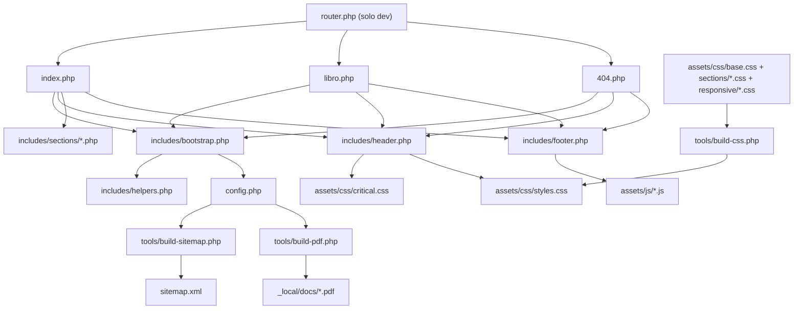
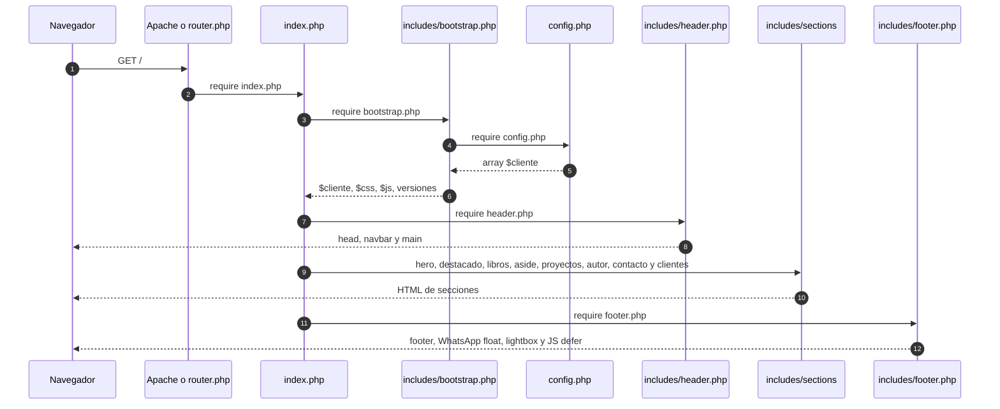
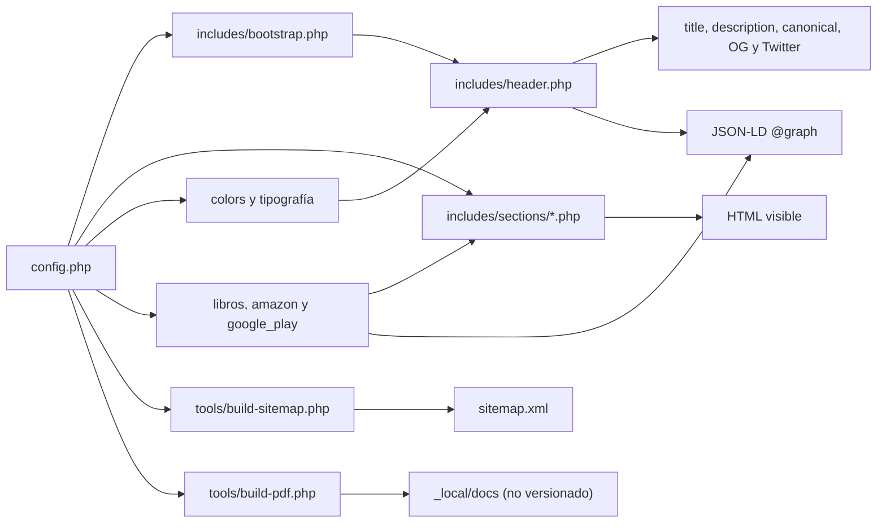

# Arquitectura — Alejandro Tinte

Landing de autor en PHP plano donde `config.php` es la fuente única de datos: `index.php` y `libro.php` componen header, secciones y footer, mientras `tools/` genera el bundle CSS, el sitemap y los PDFs operativos.

## Mapa rápido

| Ruta | Responsabilidad |
|---|---|
| `index.php` | Entry point de la home; incluye bootstrap, header, las ocho secciones y footer. |
| `libro.php` | Ficha individual `/libros/{slug}`; valida el slug contra `config.php`, resuelve el 404 y reutiliza header/footer. |
| `404.php` | Error 404 global con `noindex, follow`; lo usa Apache (`ErrorDocument`) y `router.php`. |
| `router.php` | Solo desarrollo local: sirve archivos reales, reescribe `/libros/{slug}`, redirige `/libros` y delega el resto al 404. |
| `config.php` | Fuente única de verdad: datos del autor, catálogo, precios/tiendas, SEO, redes, dominios y flags. |
| `includes/bootstrap.php` | Carga config y helpers; resuelve rutas, lista de fuentes CSS/JS y versiones por `filemtime()`. |
| `includes/helpers.php` | Escapado `e()`, WhatsApp, redes, iconos SVG, validación de assets y helpers de texto de libros. |
| `includes/header.php` | `<head>`, SEO, Open Graph, Twitter Card, JSON-LD, CSS crítico, colores, navbar y apertura de `<main>`. |
| `includes/footer.php` | Footer MiLocalWeb, badge, CTA, copyright, WhatsApp float, lightbox y scripts `defer`; cierra `</main>`. |
| `includes/sections/hero.php` | Hero con foto, nombre, slogan, descripción y CTAs. |
| `includes/sections/destacado.php` | Obra destacada a pantalla completa (`libro_destacado`). |
| `includes/sections/libros.php` | Grilla de libros, bloque de antología e imagen decorativa de cierre. |
| `includes/sections/aside.php` | Aside publicitario de MiLocalWeb, visible según `aside_visible`. |
| `includes/sections/proyectos.php` | Libros en producción, HacemeGancho, CTA para sumarse y donación. |
| `includes/sections/autor.php` | Biografía, retrato, imagen extra, redes y CTA a la obra destacada. |
| `includes/sections/contacto.php` | WhatsApp, email y redes oficiales. |
| `includes/sections/clientes.php` | Vitrina de otros clientes; retorna si `mostrar_clientes` es `false`. |
| `assets/css/base.css`, `navbar.css`, `hero.css` | Fuentes CSS de base, navegación y hero. |
| `assets/css/sections/01…08-*.css` | Ocho parciales del antiguo `sections.css`, en el orden original de cascada. |
| `assets/css/aside.css`, `clientes.css`, `footer.css` | Fuentes CSS del aside, la vitrina y el footer. |
| `assets/css/responsive/01-tablet.css`, `02-mobile.css` | Breakpoints 900 px y 600 px, en ese orden. |
| `assets/css/critical.css` | CSS above-the-fold; se inyecta inline en `header.php`. |
| `assets/css/styles.css` | **Generado** por `tools/build-css.php`; bundle minificado de 39.460 bytes. No editar a mano. |
| `assets/js/*.js` | Seis IIFE vanilla: `back-to-top`, `navbar`, `smooth-scroll`, `lightbox`, `featured-float`, `books-decor`. |
| `productos/{slug}/` | Portadas (`portada.webp`, `portada-600.webp`), PDF, `descripcion.txt`, `ficha.md` y originales de trabajo. |
| `tools/build-css.php` | Concatena las fuentes CSS en `assets/css/styles.css` con minificación conservadora. |
| `tools/build-sitemap.php` | Genera `sitemap.xml` desde `config.php` y las portadas existentes. |
| `tools/build-pdf.php` | Genera PDFs desde `_local/docs/*.md` con Chrome/Edge headless. |
| `tools/lib/markdown.php` | Conversor Markdown mínimo usado por `build-pdf.php`. |
| `docs/` | Documentación permanente del proyecto (esta carpeta). |
| `_local/docs/` | Documentación privada y datos del cliente; gitignored y no debe publicarse. |
| `.htaccess` | HTTPS, headers, caché, bloqueo de directorios y rewrites de `/libros`. |
| `robots.txt` | Reglas de rastreo y referencia al sitemap. |
| `sitemap.xml` | **Generado** por `tools/build-sitemap.php`; 12 URLs y 11 imágenes. |

## Diagrama de dependencias

## Flujo de un request

Para `/libros/{slug}`, `.htaccess:40` reescribe a `libro.php?slug={slug}`; `libro.php:16-27` normaliza el slug y lo valida contra `config.php['libros']`. Si no existe, responde 404 con el mismo layout (`libro.php:33-54`). La ficha reutiliza `bootstrap.php`, `header.php` y `footer.php`, y ajusta canonical, Open Graph y JSON-LD con `$libro_actual` (`libro.php:93-100`).

## Flujo de datos

## CSS y JS

**CSS.** No hay preprocesador ni framework. El orden de cascada vive en `tools/build-css.php:23-43` y replica el orden histórico: `base` → `navbar` → `hero` → `sections/01-destacado` → `02-libros` → `03-lightbox` → `04-proyectos` → `05-autor` → `06-contacto` → `07-libro` → `08-animaciones` → `aside` → `clientes` → `footer` → `responsive/01-tablet` → `responsive/02-mobile`.

- `assets/css/sections.css` (1.150 líneas) se dividió en ocho parciales; el mayor es `sections/02-libros.css` con 381 líneas.
- `assets/css/responsive.css` (409 líneas) se dividió en `responsive/01-tablet.css` (311) y `responsive/02-mobile.css` (98).
- `tools/build-css.php` concatena, elimina comentarios y colapsa espacios (`:56-64`), y escribe `assets/css/styles.css` (`:66-73`). El bundle actual pesa 39.460 bytes y su SHA-256 es `E398D736E0071109003843ECBF6E806DE61307F713F2F7D36CC90CA8FDD4C28F`.
- `includes/header.php:216-219` inyecta `critical.css` inline; `:221-223` carga el bundle con `preload` + `onload` y fallback `<noscript>`.
- Regla: **nunca** editar `assets/css/styles.css` a mano. Se regenera con `php tools/build-css.php`. Agregar solo comentarios a los parciales no cambia el hash porque el minificador los elimina.

**JS.** No hay build ni bundle. `includes/bootstrap.php:54-61` define seis archivos; `includes/footer.php:173-175` los imprime al final del body con `defer`. El cache busting se resuelve por archivo con `filemtime()` (`bootstrap.php:63-73`). Cada script se auto-protege si su nodo no existe.

## Invariantes

- `config.php` es la fuente única de verdad: datos, catálogo, SEO, redes y flags.
- No editar `assets/css/styles.css` ni `sitemap.xml` a mano: son artefactos generados.
- Mantener el orden de las secciones de `index.php:21-28`: hero → destacado → libros → aside → proyectos → autor → contacto → clientes.
- Mantener el orden de parciales CSS de `tools/build-css.php:23-43`; el build debe reproducir el bundle byte a byte.
- `libros_pdf_publico = false` debe ocultar el PDF en la UI, pero el bloqueo HTTP sigue pendiente (P1).
- `seo_og_image` debe existir y medir 1200x630 (`config.php:344`).
- Todo output de datos del cliente debe pasar por `e()` (`includes/helpers.php:18-21`), salvo las excepciones documentadas en SEC-05.
- El footer estándar de MiLocalWeb y el WhatsApp float no se eliminan.
- `_local/` no se copia al docroot ni al deploy.

## Cómo trabajar con IA

1. Leer `AGENTS.md` de la raíz.
2. Leer `docs/estado-actual.md` y este archivo.
3. Leer `config.php` antes de tocar cualquier sección.
4. Si se toca CSS, ejecutar `php tools/build-css.php` y comparar el hash con la línea base.
5. Si se toca el catálogo o los dominios, ejecutar `php tools/build-sitemap.php`.
6. Verificar con `php -l`, una captura HTTP y una revisión de los P0/P1 de `estado-actual.md`.
7. No tocar `_local/` ni publicar sus documentos.

## Riesgos estructurales

- **Canonical fijo y 301 de alias:** desde 2026-11-10, canonical/OG/JSON-LD usan `config['dominio']` y `.htaccess` redirige los 5 alias al dominio canónico. Queda validarlo en el hosting real (Apache).
- **`_local/` dentro del docroot:** contiene PII y no está bloqueado por `.htaccess`; el riesgo depende del método de deploy.
- **`productos/` publica más que portadas:** PDFs, `ficha.md` y `descripcion.txt` responden 200 aunque el flag de negocio esté en `false`.
- **Bloqueo incompleto en `.htaccess`:** `^(config|includes|tools)/` no cubre `config.php` y la CSP no declara `media-src`.
- **Lista CSS duplicada:** `$cssSourceFiles` (`includes/bootstrap.php:32-49`) y `$sourceFiles` (`tools/build-css.php:23-43`) deben mantenerse sincronizadas; hoy el runtime no usa la primera.
- **Assets fuera de convención:** espacios, mayúsculas y acentos en nombres, más originales pesados versionados.
- **Sin tests automatizados:** la verificación es manual (`php -l`, HTTP, smoke test); no hay CI ni Lighthouse reproducible.
- **Documentación privada fuera de git:** `_local/` está gitignored; esta carpeta `docs/` recién se crea y aún no está commiteada.
