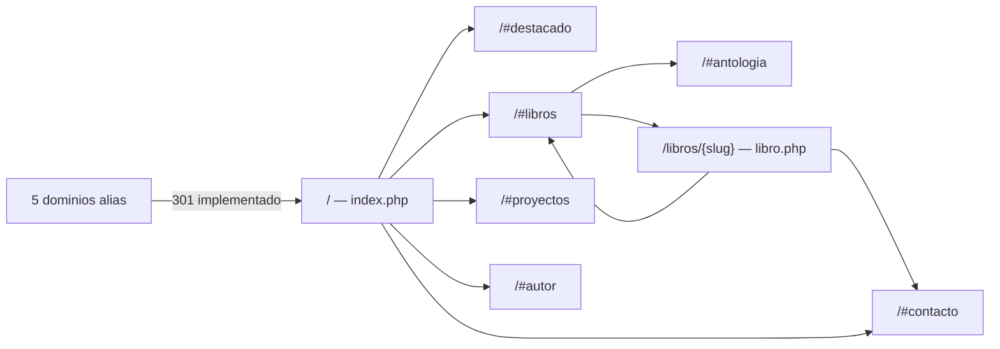

# Mapa del sitio — Alejandro Tinte

Sitio de autor con una home single-page y once fichas de libro en `/libros/{slug}`; no hay e-commerce, local comercial ni páginas de categoría.

## URLs y rutas

| URL | Archivo/route | Propósito | Indexable | Canonical | Estado |
|---|---|---|---|---|---|
| `/` | `index.php` | Home con hero, destacado, libros, proyectos, autor y contacto | Sí | `https://{host}/` | 200 (113.758 bytes) |
| `/index.php` | `index.php` | Duplicado de la home | Sí, canonical a `/` | `https://{host}/` | 200 |
| `/libros` | `router.php:31-33` / `.htaccess:43` | Redirección al ancla de libros | No (301) | — | 301 → `/#libros` |
| `/libros/{slug}` | `libro.php` | Ficha individual de libro | Sí | `https://{host}/libros/{slug}` | 200 (`mi-amigo-trotta`, `renacer-y-despegar`) |
| `/libros/no-existe` | `libro.php:33-54` | 404 de libro | No (404, pero meta `index, follow`) | `https://{host}/` (por defecto) | 404 |
| `/ruta-inexistente` | `404.php` | 404 global | No (`noindex, follow`) | `https://{host}/` (por defecto) | 404 |
| `/404.php` | `404.php` | Página 404 directa | No | `https://{host}/` | 404 |
| `/robots.txt` | `robots.txt` | Reglas de rastreo | — | — | 200 |
| `/sitemap.xml` | `sitemap.xml` (generado por `tools/build-sitemap.php`) | Sitemap | — | — | 200 (5.452 bytes) |
| `/assets/css/styles.css` | `assets/css/styles.css` (generado) | Bundle CSS | — | — | 200 (39.460 bytes) |
| `/assets/css/base.css` | `assets/css/base.css` | Fuente CSS | — | — | 200 (6.962 bytes) |
| `/assets/js/navbar.js` | `assets/js/navbar.js` | JS navbar | — | — | 200 (1.450 bytes) |
| `/assets/img/cliente/logos/og-alejandrotinte-1200x630.jpg` | asset | OG image | — | — | 200 (121.386 bytes) |
| `/assets/img/cliente/iconos/favicon.ico` | asset | Favicon | — | — | 200 (22.912 bytes) |
| `/productos/{slug}/portada-600.webp` | asset | Portada de grilla | — | — | 200 |
| `/productos/{slug}/{slug}.pdf` | asset | PDF completo | **No debería** | — | **200** (ej. 421.613 y 2.183.036 bytes) |
| `/productos/{slug}/ficha.md` | asset | Notas internas | **No debería** | — | **200** |
| `/productos/{slug}/descripcion.txt` | asset | Texto de venta | **No debería** | — | **200** |
| `/_local/docs/ficha-cliente.md` | asset | Documento privado con DNI | **No debería** | — | **200** en servidor local (18.211 bytes) |

## Diagrama de navegación

## Sitemap XML

- Existe en `sitemap.xml`; lo genera `tools/build-sitemap.php` desde `config.php`.
- Contiene **12 URLs**: la home y las once fichas de libro.
- Incluye **11 imágenes** (`portada-600.webp` de cada libro) con `image:loc` e `image:title`; la home no declara imagen.
- `lastmod` es `2026-11-09` en las 12 entradas; `changefreq` es `monthly`; prioridad 1.0 para home y 0.8 para fichas.
- No incluye geo ni coordenadas: el autor no tiene local comercial.
- Las 12 URLs devolvieron 200 en la verificación local.

## Anclas internas

| Ancla | Sección | Enlace desde |
|---|---|---|
| `#contenido` | `<main id="contenido">` (`includes/header.php:290`) | Skip-link (`header.php:245`). |
| `#inicio` | Hero (`includes/sections/hero.php:19`) | Brand (`header.php:252`) y “Inicio” del navbar (`header.php:272`). |
| `#destacado` | Obra destacada (`includes/sections/destacado.php:49`) | “Obra destacada” del navbar (`header.php:273`). |
| `#libros` | Grilla de libros (`includes/sections/libros.php:45`) | “Libros” del navbar (`header.php:274`), CTA del hero (`hero.php:47`), fichas y 404. |
| `#antologia` | Bloque de antología (`includes/sections/libros.php:169`) | Sin enlace en el navbar; es un ancla de la propia sección. |
| `#proyectos` | Proyectos en curso (`includes/sections/proyectos.php:39`) | “Proyectos” del navbar (`header.php:275`). |
| `#autor` | Sobre el autor (`includes/sections/autor.php:26`) | “El autor” del navbar (`header.php:276`) y `@id` del `Person` en JSON-LD. |
| `#contacto` | Contacto (`includes/sections/contacto.php:25`) | “Contacto” del navbar (`header.php:277`) y fallback de WhatsApp (`includes/helpers.php:58`). |

Las anclas de navegación de la home resuelven; el crawl no encontró anclas rotas.

## Enlaces internos y observaciones

- **Crawl:** 31 URLs internas de la home y 5 de `/libros/mi-amigo-trotta`; 0 con HTTP ≥ 400. Los 53 assets referenciados por `config.php` existen.
- **`/libros`:** redirección 301 de un solo salto a `/#libros`; no genera página indexable.
- **Fichas:** las once fichas están enlazadas desde la grilla y el sitemap; la antología tiene bloque propio.
- **404 de libro:** responde 404 real, pero conserva `meta robots=index, follow` y canonical a la home (`libro.php:33-39`; `header.php:171`). Es una señal contradictoria, no un enlace roto.
- **Duplicado de home:** `/index.php` responde 200 y canonicaliza a `/`; conviene mantenerlo así o redirigir, pero no es un P0.
- **URLs privadas alcanzables:** PDFs, `ficha.md`, `descripcion.txt` y `_local/docs/ficha-cliente.md` responden 200 por URL directa. No son enlaces del sitio, pero quedan expuestos (P0/P1 de `estado-actual.md`).
- **Alias de dominio:** los cinco alias de `config.php:352-358` redirigen con 301 al dominio canónico desde `.htaccess` (2026-11-10). El canonical se arma desde `config['dominio']`; falta validar la regla en el hosting real.
